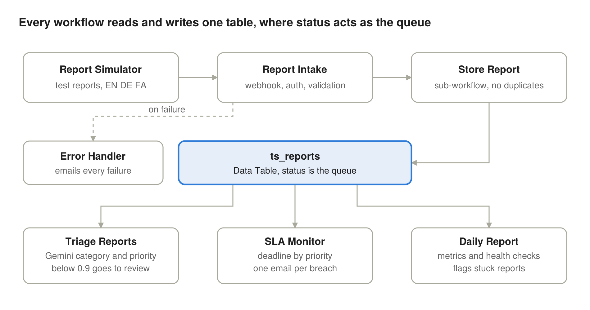

# Trust & Safety Report Triage Pipeline (n8n)

An end-to-end content-moderation pipeline built in self-hosted n8n: it receives user reports through a secured webhook, stores them idempotently, classifies them with an LLM, routes low-confidence cases to human review, monitors SLAs, alerts on failures and sends a daily health report.

Built as a hands-on learning project to practise the kind of automation used in Product Ops, BizOps and Trust & Safety teams.

📄 **Full case study** (findings, design decisions, what broke and why): [Read on Notion](https://aminkhalesianprojects.notion.site/Case-Study-Trust-Safety-Report-Triage-Pipeline-in-n8n-3f85adec5ffb81979e7ae4fb5eee8e26?pvs=74)

## What it does

| # | Workflow | Role |
|---|----------|------|
| 1 | `TS - Report Intake` | Webhook (`POST /webhook/ts/report`) with header-key auth. Validates required fields, calls the store sub-workflow, answers `200` / `400` / `503`. |
| 2 | `TS - Store Report` | Sub-workflow. Checks whether `report_id` already exists (idempotency), inserts new reports with `status = new`. |
| 3 | `TS - Report Simulator` | Sends 5 realistic test reports (sarcasm, prompt injection, a Persian threat, a false spam report...) to the webhook, one per second. |
| 4 | `TS - Triage Reports` | Gemini classifies each new report into category + priority + confidence. Confidence ≥ 0.9 → `triaged`, otherwise → `needs_review` (human in the loop). |
| 5 | `TS - SLA Monitor` | Flags reports open longer than their SLA (urgent 15 min, high 4 h, normal 24 h). Alerts once per report using an `escalated_at` column. |
| 6 | `TS - Error Handler` | Error workflow: emails the failed workflow, node and execution link. |
| 7 | `TS - Daily Report` | Metrics (auto-triage rate, AI relabel rate, SLA breaches) plus health checks for silent failures (reports stuck in `new`, processed reports with no category). |

## Key design decisions

- **Idempotency:** a duplicate `report_id` returns `200` with `stored: false` instead of creating a second row.
- **Honest failure:** if storage fails, the sender gets `503` (retry later) instead of a misleading `200`, and the error workflow is triggered.
- **Prompt-injection defence:** the prompt treats reported content as data, never as instructions.
- **Human in the loop:** self-reported LLM confidence turned out to be poorly calibrated, so the threshold is strict (0.9).
- **Alert fatigue:** error alerts only on entry-point workflows; SLA alerts only once per report.

## Setup

1. Run n8n (tested on self-hosted n8n 2.x: `npx n8n`).
2. Create a Data Table named `ts_reports` with these columns:

   | Column | Type |
   |---|---|
   | report_id, reporter_id, content_text, user_reason, status, ai_category, priority | string |
   | ai_confidence | number |
   | received_at, triaged_at, escalated_at | datetime |

3. Import the JSON files from `workflows/` (**Workflows → Import from file**).
4. Create credentials and select them in the nodes:
   - **Header Auth** (header name `X-API-Key`) for `ReceiveReport` and `SendReport`
   - **Google Gemini API** for the triage chat model
   - **Gmail OAuth2** for the alert and report nodes
5. Replace `you@example.com` in the Gmail nodes with your own address.
6. Re-select the `ts_reports` table in every Data Table node, the sub-workflow in `StoreReport`, and `TS - Error Handler` as the Error Workflow in the settings of Intake, Triage and SLA Monitor (IDs differ between n8n instances).
7. Publish `TS - Store Report`, `TS - Error Handler` and `TS - Report Intake`, then run the Simulator.

## Limitations

- The duplicate check is read-then-write, so truly simultaneous requests can still race; a production version needs a unique constraint in the database.
- Triage, SLA and daily report run manually here; in production they would use Schedule Triggers.
- Tested with a small synthetic dataset, not real traffic.

## Tech

n8n · Webhooks · Data Tables · Sub-workflows · Basic LLM Chain + Structured Output Parser · Google Gemini · Gmail · Error workflows
